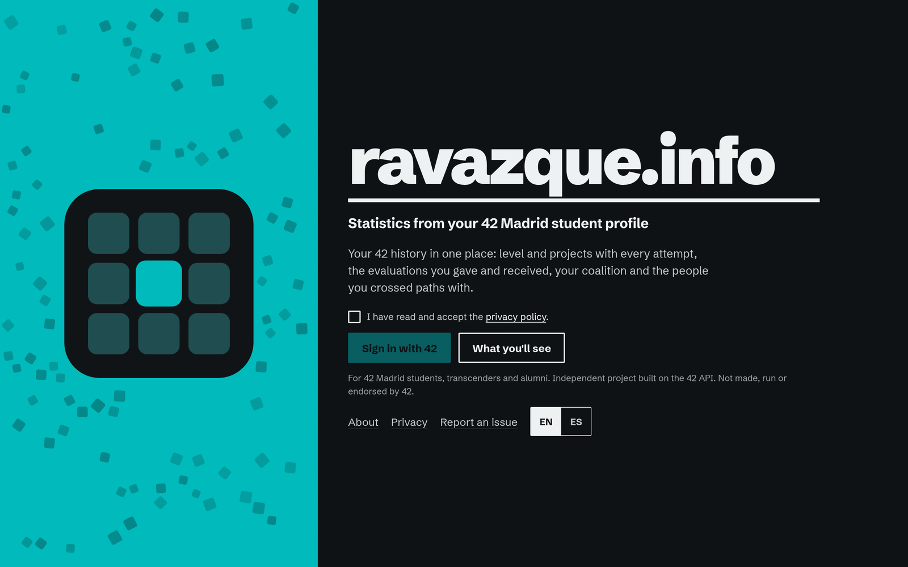
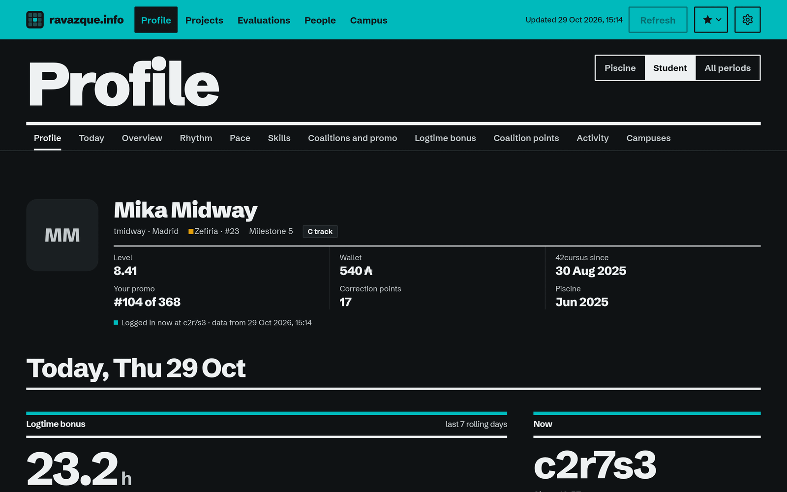
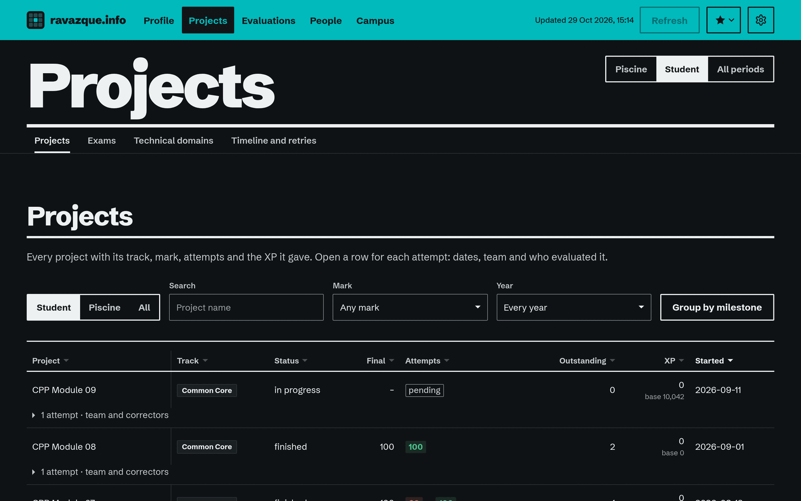
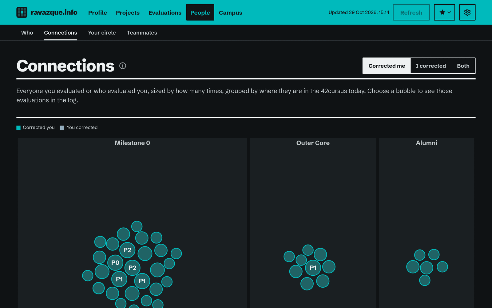
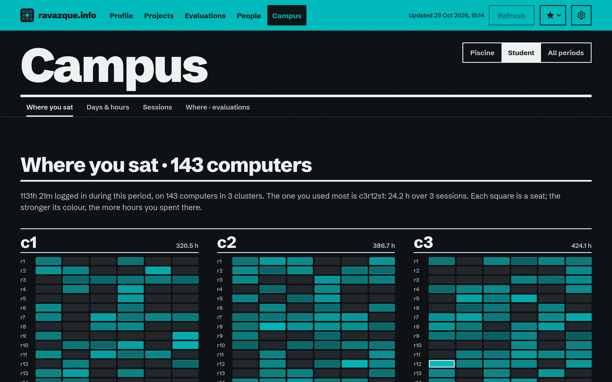
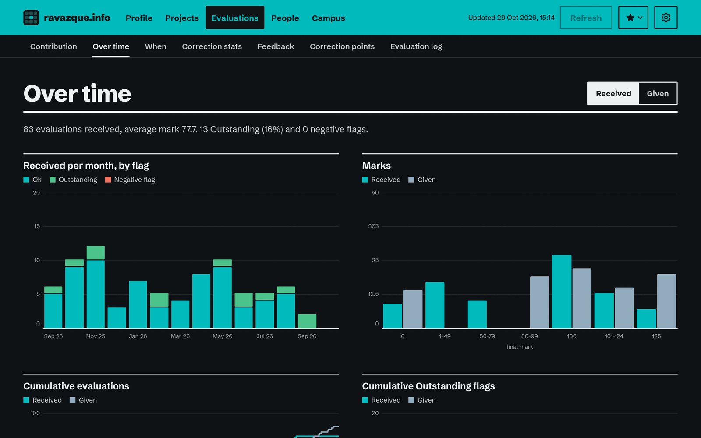

# ravazque.info

Statistics for **42 Madrid Fundación Telefónica** students, built on the 42 API. Sign in with your 42 account and see your own history in
one place: the hours you logged and where you sat, every project and retry, your exams, every evaluation you gave and
received, the people you crossed paths with, your promo and your coalition. English and Spanish, light and dark, in
the 42 blue or your coalition's colour.

Live at **https://ravazque.info**. An independent project: not made, run or endorsed by 42 or 42 Madrid Fundación Telefónica.

This repository also holds the owner's public CV page (`site/`, served at https://ravazque.github.io), which shows a
small 42 snapshot published from the app.

*<p align="left"> <c>Language selector for README.md ➜</c> <a href="docs/README.es.md">Español</a> · <b>English</b></p>*

## What you see

Five pages. Every choice (period, filters, views) lives in the address, so any view can be bookmarked or shared.

- **Profile**, the home page. Your card (photo, milestone, C or Python track, grade, groups such as mentor, wallet,
  correction points, kickoff and piscine, the estimated alumni date), then what changes today: the coalition logtime
  bonus (hours in the rolling seven days against 50 h and 80 h, when each one is due, which sessions are about to
  leave the window), where you are sitting, your last seven days hour by hour, your next evaluation and the projects
  you have open. Below: six summary modules, your rhythm, pace and blackhole, skills, coalitions and promo, the bonus
  in detail, the points you gave your coalition, achievements (one line per series, the earlier levels folded),
  titles and quests, your campuses, everyone you crossed paths with, the projects you corrected and the full
  evaluation log with search.
- **Projects**: every project and attempt with filters, grouped by milestone (0 = Libft … 6) for the C and the Python
  Common Core (a project done in both tracks says which), CSV export, exams, technical domains (the intra's RNCP tags)
  and a timeline of every attempt.
- **Evaluations**: what you give back (hours, people, rating, how many ended below 50, Outstanding both ways, by the
  other person's milestone), received and given over time, when they happen (weekday × hour, by hour of the day,
  duration, how far ahead they were booked), your feedback (as a student, only the 42cursus counts; Discovery
  piscines are set apart) and correction points.
- **People**: who evaluated you most, your connections grouped by where they are today, your circle and your
  teammates. Accounts that 42 erased are left out of the graphs (a note says how many) and read "Deleted account" in
  tables; staff get a group of their own.
- **Campus**: the seat plan with every computer you used (computers outside the clusters noted apart), days and
  hours (the first year in full, your first day marked), the sessions log, and where evaluations happen: the ones you
  received or gave, by cluster, with the other side's cluster for the last 60 days.

Things worth trying:

- The **period switch**: everything, the 42cursus only, or the C Piscine only.
- The **star** in the band: a shortcut to the best views (where you sat, who evaluated you, your circle…).
- **Refresh** your data once an hour; the extraction runs in the background with a progress bar.
- **Settings** (the gear): accent (the default 42 blue or your coalition's colour, adjusted for contrast in both
  themes), theme (system, light or dark), period and language.
- **Delete my data**: removes everything the server holds about you, at once.

Some figures are inferences, and the app says so where they appear: the logtime bonus rule (inferred from the
awards: the intra does not publish it, checked against 11 students over 12 days), the alumni date, XP per domain.

<details>
<summary>Screenshots (Test profile, not a real student; dark mode)</summary>
<br>

<p align="center">
  <a href="docs/images/landing-en.png"></a>
  <a href="docs/images/profile-en.png"></a>
</p>

<p align="center">
  <a href="docs/images/projects-en.png"></a>
  <a href="docs/images/people-en.png"></a>
</p>

<p align="center">
  <a href="docs/images/campus-en.png"></a>
  <a href="docs/images/evaluations-en.png"></a>
</p>

</details>

## Who can sign in

Students, transcenders and alumni whose main campus is 42 Madrid Fundación Telefónica. Staff, pisciners, blackholed and frozen accounts see
a page with the reason. Access is checked again on every refresh.

## Your data

- **No database.** Your report lives in your browser (IndexedDB). The server keeps a signed copy in memory for one hour
  after its last use, and accepts the browser's copy back only with its own signature for your account.
- Your 42 token is used once to know who you are and then dropped; tokens never reach the browser.
- About other students the app keeps only login, name, milestone and whether they are staff. Of the feedback you
  received, only yours.
- The only file the server writes is the consent record: a keyed hash of your 42 id, the policy version and the date,
  kept for two years.
- *Delete my data* clears the server's copy, cancels a pending refresh and tells your browser to clear its storage.
- Students who ask to be left out appear as "Hidden" in everyone's reports (`OPTOUT_LOGINS`).

The full policy is on the Privacy page of the app. Security issues: see [SECURITY.md](SECURITY.md).

## Stack

- **Server**: Go 1.27, standard library only. One binary with the 42 API client and extraction (`server/api42/`), the
  analysis and the curriculum rules (`server/core/`) and the web server: sign-in with 42 OAuth2, a JSON API, an
  in-process job queue and an in-memory store with expiry (`server/internal/`).
- **Browser app**: Vue 3.5, Vue Router 5 and TypeScript 5.9, built with Vite 8 and embedded in the binary
  (`web/`). The charts are its own SVG and HTML, no chart library.
- **Serving**: Docker Compose, Caddy 2.11 (HTTPS, headers, compression) and, in production, a Cloudflare tunnel. The
  image is built in stages (Node 26 → Go 1.27 → distroless) and runs as a non-root user; every base image is pinned by
  digest.
- **Tests**: Go's `testing`, Vitest 5 and `node --test`.
- `.v1_old/`: the first version (Python, FastAPI, htmx), archived and not built.

## Build and run

```
make                 # list the commands
make certs           # HTTPS certificates for https://localhost (mkcert if present, else openssl)
make dev             # build and start https://localhost with your saved report and the test profiles
make dev-logs        # follow dev's logs
make dev-down        # stop dev (browsers keep their reports)
make build           # refresh dev's image and your saved report (DEV_UID, ~120 requests, ~40 s)
make test            # Go tests, type check and Vitest, the site's tests
make production      # build and start https://ravazque.info through the Cloudflare tunnel
make prod-down       # stop production (the consent log stays in its volume)
make logs            # follow production's logs
make site            # build the CV page into site/_build and serve it at http://localhost:8080
make snapshot        # site/data/42.json from the saved report: what the publish button would send
make clean           # dev-down and generated files
make fclean          # clean, dev's image, volumes and saved reports, and web/node_modules
make re              # fclean and dev
```

`clean`, `fclean`, `re`, `build` and `test` never touch production: only `make production`, `make prod-down` and
`make logs` do.

Requirements: Docker with the Compose plugin, `make`, and `mkcert` or `openssl`. Go 1.27 and Node 26 only for
`make test` and the dev tools.

### First run

1. Register the 42 applications at https://profile.intra.42.fr/oauth/applications (scope `public`): one for dev with
   the redirect URI `https://localhost/auth/callback`, one for production with `https://ravazque.info/auth/callback`.
   A third one is optional and only adds request budget.
2. Run `make`: it copies `.env.example` to `.env`. Fill it (below) and keep it private (`chmod 600 .env`).
3. `make certs`, then `make dev`, and open https://localhost.

### Configuration

Everything lives in one `.env`, never committed. `.env.example` explains each value:

```
FT_UID, FT_SECRET            # 42 app that signs users in to production
FT_UID_2, FT_SECRET_2        # 42 app that signs users in to dev
FT_UID_3, FT_SECRET_3        # optional: more request budget, never signs anyone in
SESSION_SECRET               # openssl rand -hex 32
CONTROLLER_NAME              # data controller named by the privacy policy
CONTACT_EMAIL                # contact for privacy requests (About and Privacy pages)
TUNNEL_TOKEN                 # production: the Cloudflare tunnel's token
DEV_UID                      # dev: your 42 user id, whose report make build saves
OPTOUT_LOGINS                # optional: logins shown as "Hidden"
ISSUES_URL                   # optional: "Report an issue" link
OWNER_LOGIN, GITHUB_TOKEN,   # optional: the publish button (hidden unless OWNER_LOGIN
GITHUB_REPO, GITHUB_BRANCH   #   and GITHUB_TOKEN are set)
```

## Modes

- **Dev** (`make dev`, https://localhost) signs in with the second 42 app. The landing also offers **Dev · login**,
  which enters with your saved report without going through 42, and three **Test** profiles (a new student, one
  halfway through the Common Core, an alumni): synthetic data moved to today's date, never real people, never able to
  publish or refresh. A code change needs `make dev` again.
- **Production** (`make production`, https://ravazque.info) signs in with the first app and is served through a named
  Cloudflare tunnel (Zero Trust → Networks → Tunnels: a Docker connector whose public hostname points to
  `http://caddy:8080`; its token goes in `TUNNEL_TOKEN`). Dev and production are separate Compose projects and can run
  side by side.

### Updating production

```
git pull --rebase    # the new code (and anything the publish button committed)
make prod-down       # optional: stops the containers; the volumes (the consent log) stay
make production      # rebuilds the image from the code you have and starts it again
```

`make production` alone also works: it rebuilds and replaces only what changed, with a few seconds offline. Never
add `-v` to a `down` by hand: that deletes the volumes, consent log included. What a restart clears is the memory:
everyone signs in again, and their reports come back from their browsers (the server's signature still matches while
`SESSION_SECRET` stays the same). Data that a new version adds to the report appears after each person's next
refresh.

### The 42 API budget

Each 42 app may make 2 requests per second and 1200 per hour, shared by every user, so the app is careful with it:

- one refresh per user per hour, one at a time;
- lists fetched in batches of 100 and independent lists fetched together;
- requests spread over all configured apps.

A full refresh takes about 120 requests and 40 seconds with three apps, and every refresh logs its request count.
When the hourly budget runs low, the job waits for the next hour.

## The public site and its workflow

`site/` is a static page with the owner's CV (`site/cv.json`, edited by hand, EN/ES) and a 42 snapshot
(`site/data/42.json`). The **Publish** button in the app (owner only) writes that snapshot and commits it to `main`
through the GitHub API. The snapshot is a field-by-field whitelist: level, cursus state, validated projects,
evaluation counts, coalition and top skills. It never includes contact data, seats, hours, ids, tokens, photos or
anything about other students.

Setup:

1. Create a fine-grained token at https://github.com/settings/personal-access-tokens with access to this repository
   only and **Contents: Read and write**. Put it in `GITHUB_TOKEN`, along with `GITHUB_REPO` and `OWNER_LOGIN`.
2. In Settings → Pages, set **Source: GitHub Actions**, so that only `site/` is ever published.
3. Since the button commits to `main`, run `git pull --rebase` before pushing local work.

## CI/CD

Every push and pull request runs `.github/workflows/ci.yml`:

- `go`: vet, tests with the race detector and govulncheck;
- `web`: type check, tests, build and `npm audit` of the browser app, and the site's tests;
- `image`: the Docker image builds;
- `secrets`: gitleaks over the whole history, plus a guard that no private file (`.env`, build output, local folders)
  is tracked.

`main` is protected: all four checks must pass, and force-push and deletion are blocked. When CI passes on `main`,
`pages.yml` deploys `site/` to GitHub Pages. CodeQL scans Go, TypeScript and the workflows, and Dependabot proposes
weekly updates for Go, npm, Docker and Actions. Actions are pinned to commit SHAs.

The web app itself is not deployed by CI: production runs on the owner's machine and is updated with
`make production`.

## Tests

`make test` runs everything:

- the Go tests next to their code in `server/`. The analysis is checked against golden files that the first version
  produced from the same data, key order included;
- the browser app's tests in `web/src/` (Vitest), which also check that every text key exists in both languages;
- the site's tests in `site/tests/`.

Fixtures are anonymised or synthetic.

## Customising

- `server/core/data/ui.json`: colours for both themes, type, spacing, breakpoints and panel layout, served as `/ui.css`.
- `server/core/data/i18n/{en,es}.json`: every text; both files must have the same keys.
- `server/core/data/tracks.json`: which Common Core milestone each project belongs to, for the C and the Python
  tracks. Any other 42cursus project counts as Outer Core.
- `server/core/data/skills.json` (skill order) and `rncp.json` (the projects behind each RNCP tag).

## License

[AGPL-3.0](LICENSE). If you run a modified version as a network service, you must offer its source to its users.
