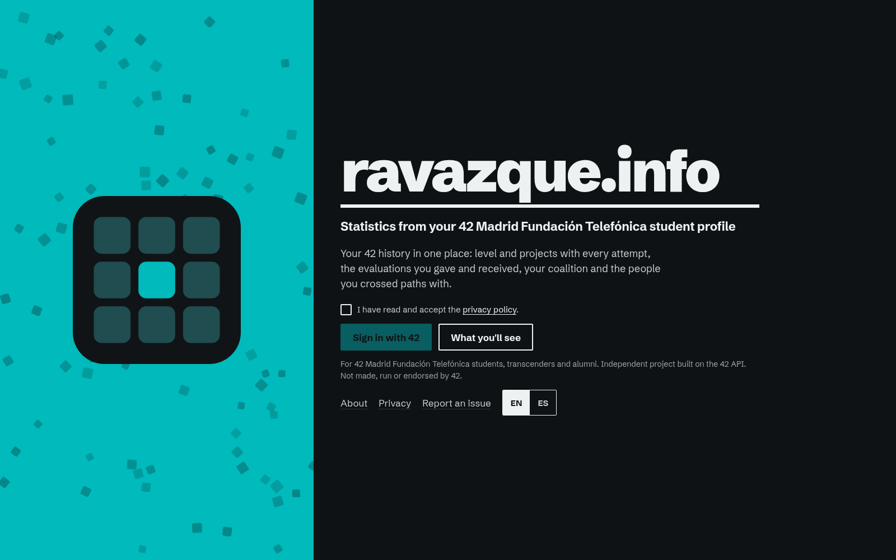
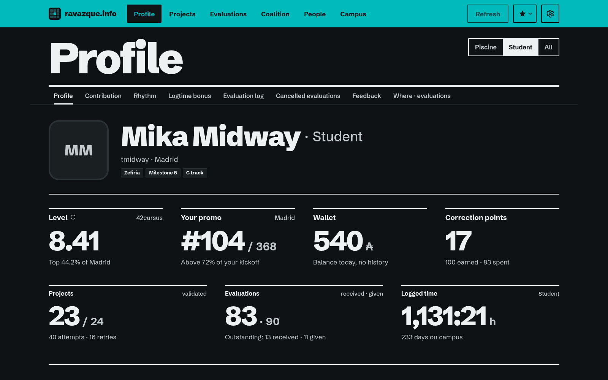
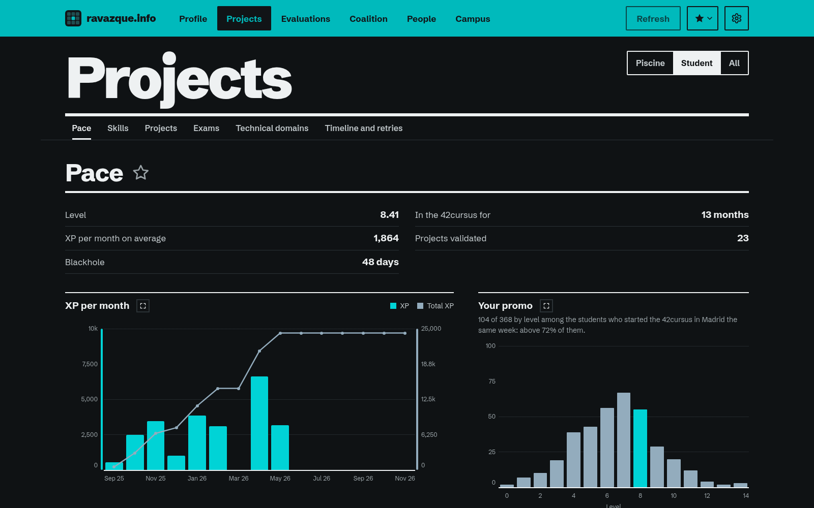
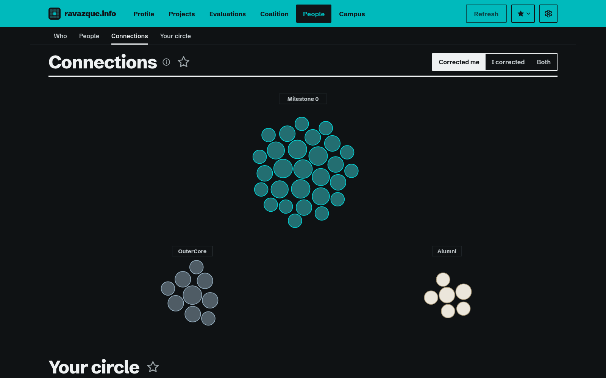
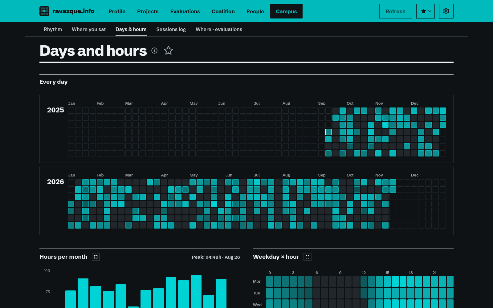
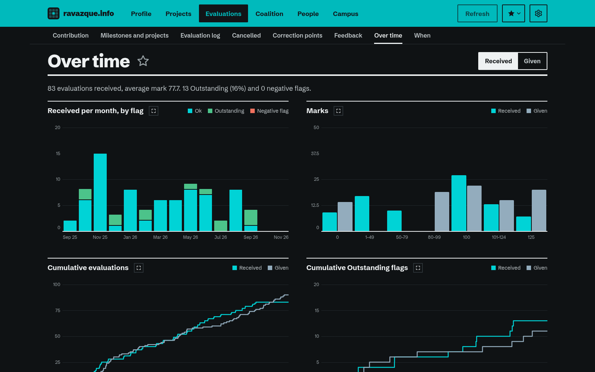

# ravazque.info

Statistics for **42 Madrid Fundación Telefónica** students, built on the 42 API. Sign in with your 42 account and see your own history in
one place: the hours you logged and where you sat, every project and retry, your exams, every evaluation you gave and
received, the people you crossed paths with, your promo and your coalition. English and Spanish, light and dark, in
the 42 blue or your coalition's colour.

Live at **https://ravazque.info**. An independent project: not made, run or endorsed by 42 or 42 Madrid Fundación Telefónica.

This repository also holds the owner's public CV page (`site/`, served at https://ravazque.github.io), which shows a
small 42 snapshot published from the app.

*<p align="left"> <c>Language selector for README.md ➜</c> <a href="docs/README.es.md">Español</a> · <b>English</b></p>*

## What you see

Six pages. Every choice (period, filters, views) lives in the address, so any view can be bookmarked or shared.

- **Profile**, the home page. Your card (photo, name and login, the title you chose on the intra, coalition, milestone,
  C or Python track, grade, groups such as mentor) with four figures, each with a line: your level and your place among
  Madrid's students, OuterCore, frozen and alumni (read again every hour), your rank in your kickoff, your wallet and
  your correction points earned and spent. Then three summary modules (projects, evaluations and logged time), your
  path on a timeline (Piscine, 42cursus, campus moves, Transcender, alumni, today and the estimated alumni date) and the
  sections of the other pages you keep there as widgets: Contribution, Rhythm, the logtime bonus, the evaluation log,
  cancelled evaluations, feedback and where evaluations happen to begin with. Add more from the picker at the bottom
  (Activity among them: achievements, events, titles and quests beside your campuses), remove, resize and drag them into
  place; it is kept in your browser.
- **Projects**: your pace (level, XP per month, your promo by level, the estimated alumni date), skills, every project
  and attempt with filters, grouped by milestone (0 = Libft … 6) for the C and the Python Common Core (a project done
  in both tracks says which), CSV export, exams, technical domains (the intra's RNCP tags) and a timeline of every attempt.
- **Evaluations**: what you give back (hours, people, rating, how many ended below 50, Outstanding both ways, by the
  other person's milestone), received and given over time, when they happen (weekday × hour, duration, how far
  ahead they were booked), your feedback (as a student, only the 42cursus counts; Discovery
  piscines are set apart), correction points, cancelled evaluations (the ones of your projects you cancelled, with the
  project they probably were; the ones your corrector cancelled; the ones you were to give and cancelled; the times your
  corrector didn't come), the projects you corrected and the full evaluation log: search and filters by flag (absences
  too), the project's milestone, project and seat (not logged, logged in late, by cluster), who marked whom absent, how
  late the evaluated side logged in, and a team's leader with the rest one click away.
- **Coalition**: the coalitions of Madrid, refreshed every quarter of an hour, and every point you gave yours, the
  logtime bonus in detail with every bonus so far, your points by source (every source, at nothing too) and per month by
  source (hover a month for its parts). Deductions read as TIGs.
- **People**: who evaluated you most, everyone you met (or only your teammates), your connections grouped by where
  they are today and your circle. Accounts that 42 erased are left out of the graphs (a note says how many) and
  read "Deleted account" in tables; staff get a group of their own. A login in a table or list opens that student's page
  on acerezo.top, another independent site, in a new tab.
- **Campus**: your rhythm (streak, active weeks, your day hour by hour), the seat plan with every computer you used
  (computers outside the clusters noted apart), days and hours (the first year in full, your first day marked), the
  sessions log, where evaluations happen (the ones you received or gave, by cluster, with the other side's cluster for
  the last 60 days). Sessions on other campuses count as time but stay off Madrid's seats and clusters.

Things worth trying:

- The **period switch**: everything, the 42cursus only, or the C Piscine only.
- The **star** by every section's title: starred sections gather in the star menu of the band, one click away.
- **Refresh** your data once an hour; the extraction runs in the background with the progress in the band, and when
  you come back after an hour your browser's copy draws the page at once while a fresh one is fetched.
- The **enlarge** button by a chart that shares its row (on a phone, every chart) opens it large.
- **Settings** (the gear): accent (the default 42 blue or your coalition's colour, adjusted for contrast in both
  themes), theme (system, light or dark), period and language.
- **Delete my data**: removes everything the server holds about you, at once.

Some figures are inferences, and the app says so where they appear: the logtime bonus rule (inferred from the
awards: the intra does not publish it, checked against 11 students over 12 days), the alumni date, XP per domain, the
seats and lateness worked out from login sessions, and which cancelled evaluations you cancelled yourself (with the
project they probably were). 42 deletes a cancelled evaluation, so those are read from your correction points; when the
student you were to evaluate cancels, nothing is written on your side and it can't be counted.

<details>
<summary>Screenshots (Test profile, not a real student; dark mode)</summary>
<br>

<p align="center">
  <a href="docs/images/landing-en.png"></a>
  <a href="docs/images/profile-en.png"></a>
</p>

<p align="center">
  <a href="docs/images/projects-en.png"></a>
  <a href="docs/images/people-en.png"></a>
</p>

<p align="center">
  <a href="docs/images/campus-en.png"></a>
  <a href="docs/images/evaluations-en.png"></a>
</p>

</details>

## Who can sign in

Students, transcenders and alumni whose main campus is 42 Madrid Fundación Telefónica. Staff, pisciners, blackholed and frozen accounts see
a page with the reason. Access is checked again on every refresh.

## Your data

- **No database.** Your report lives in your browser (IndexedDB). The server keeps a signed copy in memory for one hour
  after its last use, and accepts the browser's copy back only with its own signature for your account.
- Your 42 token is used once to know who you are and then dropped; tokens never reach the browser.
- About other students the app keeps only login, name, group (milestone, alumni, blackholed…) and whether they are
  staff and, for your evaluations of the last 60 days, the seat the other side used (and how late the students you
  evaluated logged in). Of the feedback you received, only yours.
- The only file the server writes is the consent record: a keyed hash of your 42 id, the policy version and the date,
  kept for two years.
- *Delete my data* clears the server's copy, cancels a pending refresh and tells your browser to clear its storage.
- Students who ask to be left out appear as "Hidden", with no name or seat, in everyone's reports (`OPTOUT_LOGINS`).
- For your place in Madrid, the server reads every Madrid 42cursus student's level once an hour (only in hours someone
  opens a page) and keeps only the numbers, in memory: no login, name or id.
- A login link to acerezo.top sends that login to that site only when you click it, without saying which page you came from.
- The server runs on Amazon Web Services in the EU (Stockholm) and is reached through Cloudflare.

The full policy is on the Privacy page of the app. Security issues: see [SECURITY.md](SECURITY.md).

## Stack

- **Server**: Go 1.27, standard library only. One binary with the 42 API client and extraction (`server/api42/`), the
  analysis and the curriculum rules (`server/core/`) and the web server: sign-in with 42 OAuth2, a JSON API, an
  in-process job queue and an in-memory store with expiry (`server/internal/`).
- **Browser app**: Vue 3.5, Vue Router 5 and TypeScript 5.9, built with Vite 8 and embedded in the binary
  (`web/`). The charts are its own SVG and HTML, no chart library.
- **Serving**: Docker Compose, Caddy 2.11 (HTTPS, headers, compression) and, in production, a Cloudflare tunnel. The
  image is built in stages (Node 26 → Go 1.27 → distroless) and runs as a non-root user; every base image is pinned by
  digest.
- **Tests**: Go's `testing`, Vitest 5 and `node --test`.

## Build and run

```
make                 # list the commands
make certs           # HTTPS certificates for https://localhost (mkcert if present, else openssl)
make dev             # build, start and open https://localhost in Chrome with no saved profiles (real 42 sign-in only)
make dev-build       # dev plus the synthetic test profiles
make dev-real        # dev-build plus the real profiles of DEV_REAL_LOGINS (fetched once, ~120 requests each)
make dev-live        # dev-real plus editing live: opens the browser app from web/src at http://localhost:5173 in Chrome
make dev-logs        # follow dev's logs
                     # every dev level attaches to a dev already up, unless the code, settings or level changed; make dev-down lowers a level
make dev-down        # stop dev (browsers keep their reports)
make test            # Go tests, type check and Vitest, the site's and the evaluation report's tests
make production      # build and start https://ravazque.info through the Cloudflare tunnel
make production-down # stop production (the consent log stays in its volume)
make logs            # follow production's logs
make site            # build the CV page into site/_build and serve it at http://localhost:8080
make snapshot        # site/data/42.json from the saved report: what the publish button would send
make eval-report     # ask for a 42 login and write its evaluation history as one private HTML page (~130 requests)
make report          # the same, then open the page in Chrome
make clean           # dev-down and generated files
make fclean          # clean, dev's image, volumes and saved reports, and web/node_modules
make re              # fclean and dev-build
```

`clean`, `fclean`, `re` and `test` never touch production: only `make production`, `make production-down` and
`make logs` do.

Requirements: Docker with the Compose plugin, `make`, and `mkcert` or `openssl`. Go 1.27, Node 26 and Python 3.12 only
for `make test` and the dev tools.

### First run

1. Register the 42 applications at https://profile.intra.42.fr/oauth/applications (scope `public`): one for dev with
   the redirect URI `https://localhost/auth/callback`, one for production with `https://ravazque.info/auth/callback`.
   A third one is optional and only adds request budget.
2. Run `make`: it copies `.env.example` to `.env`. Fill it (below) and keep it private (`chmod 600 .env`).
3. `make certs`, then `make dev-build`: https://localhost opens in Chrome.

### Configuration

Everything lives in one `.env`, never committed. `.env.example` explains each value:

```
FT_UID, FT_SECRET            # 42 app that signs users in, production and dev; also answers requests
FT_UID_2, FT_SECRET_2        # optional: more request budget, never signs anyone in
FT_UID_3, FT_SECRET_3        # optional: more request budget, never signs anyone in
SESSION_SECRET               # openssl rand -hex 32
CONTROLLER_NAME              # data controller named by the privacy policy
CONTACT_EMAIL                # contact for privacy requests (About and Privacy pages)
TUNNEL_TOKEN                 # production: the Cloudflare tunnel's token
DEV_REAL_LOGINS              # dev: 42 logins (comma-separated) whose real reports make dev-real serves
OPTOUT_LOGINS                # optional: logins shown as "Hidden"
ISSUES_URL                   # optional: "Report an issue" link
OWNER_LOGIN, GITHUB_TOKEN,   # optional: the publish button (hidden unless OWNER_LOGIN
GITHUB_REPO, GITHUB_BRANCH   #   and GITHUB_TOKEN are set)
```

## Modes

- **Dev** (`make dev-build`, https://localhost) signs in with the second 42 app. The landing also offers seven
  **Test** profiles (a new student, one halfway through the Common Core, an Outer Core transcender, an alumni, a
  Python-track student, a Python-track transcender and a student who moved from C to Python): synthetic data moved to
  today's date, never real people, never able to publish or refresh. `make dev-real` adds **Real · login** for the
  logins in `DEV_REAL_LOGINS`, saved in `web/preview/` (local only). A code change needs `make dev-build` again; `make dev-live` shows the
  browser app's changes at once (`ui.json` and the server still need the rebuild).
- **Production** (`make production`, https://ravazque.info) signs in with the first app and is served through a named
  Cloudflare tunnel (Zero Trust → Networks → Tunnels: a Docker connector whose public hostname points to
  `http://caddy:8080`; its token goes in `TUNNEL_TOKEN`). Dev and production are separate Compose projects and can run
  side by side. It runs on one machine, today an AWS EC2 in Stockholm.

### Updating production

On the machine that serves it:

```
git pull --rebase    # the new code (and anything the publish button committed)
make production-down # optional: stops the containers; the volumes (the consent log) stay
make production      # rebuilds the image from the code you have and starts it again
```

`make production` alone also works: it rebuilds and replaces only what changed, with a few seconds offline. Never
add `-v` to a `down` by hand: that deletes the volumes, consent log included. What a restart clears is the memory:
everyone signs in again, and their reports come back from their browsers (the server's signature still matches while
`SESSION_SECRET` stays the same). Data that a new version adds to the report appears after each person's next
refresh.

### The 42 API budget

Each 42 app may make 2 requests per second and 1200 per hour, shared by every user, so the app is careful with it:

- one refresh per user per hour, one at a time;
- lists fetched in batches of 100 and independent lists fetched together;
- requests spread over all configured apps.

A full refresh takes about 120 requests and 40 seconds with three apps, and every refresh logs its request count.
When the hourly budget runs low, the job waits for the next hour. Madrid's levels (your place on Profile) cost about 26
requests, at most once per hour, shared by everyone, and only in an hour in which someone opens a page.

## The public site and its workflow

`site/` is a static page with the owner's CV (`site/cv.json`, edited by hand, EN/ES) and a 42 snapshot
(`site/data/42.json`). The **Publish** button in the app (owner only) writes that snapshot and commits it to `main`
through the GitHub API. The snapshot is a field-by-field whitelist: level, cursus state, validated projects,
evaluation counts, coalition and top skills. It never includes contact data, seats, hours, ids, tokens, photos or
anything about other students.

Setup:

1. Create a fine-grained token at https://github.com/settings/personal-access-tokens with access to this repository
   only and **Contents: Read and write**. Put it in `GITHUB_TOKEN`, along with `GITHUB_REPO` and `OWNER_LOGIN`.
2. In Settings → Pages, set **Source: GitHub Actions**, so that only `site/` is ever published.
3. Since the button commits to `main`, run `git pull --rebase` before pushing local work.

## CI/CD

Every push and pull request runs `.github/workflows/ci.yml`:

- `go`: vet, tests with the race detector and govulncheck;
- `web`: type check, tests, build and `npm audit` of the browser app, the site's tests and the evaluation report's tests;
- `image`: the Docker image builds;
- `secrets`: gitleaks over the whole history, plus a guard that no private file (`.env`, build output, local folders)
  is tracked.

`main` is protected: all four checks must pass, and force-push and deletion are blocked. When CI passes on `main`,
`pages.yml` deploys `site/` to GitHub Pages. CodeQL scans Go, TypeScript and the workflows, and Dependabot proposes
weekly updates for Go, npm, Docker and Actions. Actions are pinned to commit SHAs.

The web app itself is not deployed by CI: production runs on the owner's machine and is updated with
`make production`.

## Tests

`make test` runs everything:

- the Go tests next to their code in `server/`. The analysis is checked against saved golden files, key order
  included;
- the browser app's tests in `web/src/` (Vitest), which also check that every text key exists in both languages;
- the site's tests in `site/tests/`;
- the evaluation report's tests in `tools/evaluation-report/`.

Fixtures are anonymised or synthetic.

## Tools

- [`tools/evaluation-report`](tools/evaluation-report/README.md): `make eval-report` asks for a 42 login and writes that student's evaluation
  history as one private HTML page: every attempt with its correctors, times and seats. It runs locally, is not part of the
  deployed app, and could become a page of it later. It hides the students in `OPTOUT_LOGINS` as the app does, but stays
  outside the site's privacy policy: see its Privacy section.

## Customising

- `server/core/data/ui.json`: colours for both themes, type, spacing, breakpoints and panel layout, served as `/ui.css`.
- `web/src/styles/spacing.css`: every distance and line of each page, section by section, to tune by hand (negative
  values bring things closer).
- `web/src/styles/zoom.css`: the panel that opens a chart large (width, height, position, padding, the chart's
  height, how dark the page behind gets).
- `server/core/data/i18n/{en,es}.json`: every text; both files must have the same keys.
- `server/core/data/tracks.json`: which Common Core milestone each project belongs to, for the C and the Python
  tracks. Any other 42cursus project counts as Outer Core.
- `server/core/data/skills.json` (skill order) and `rncp.json` (the projects behind each RNCP tag).

## License

[AGPL-3.0](LICENSE). If you run a modified version as a network service, you must offer its source to its users.
