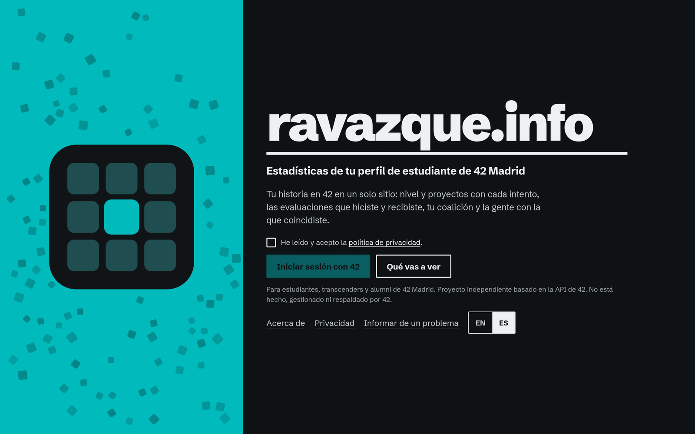
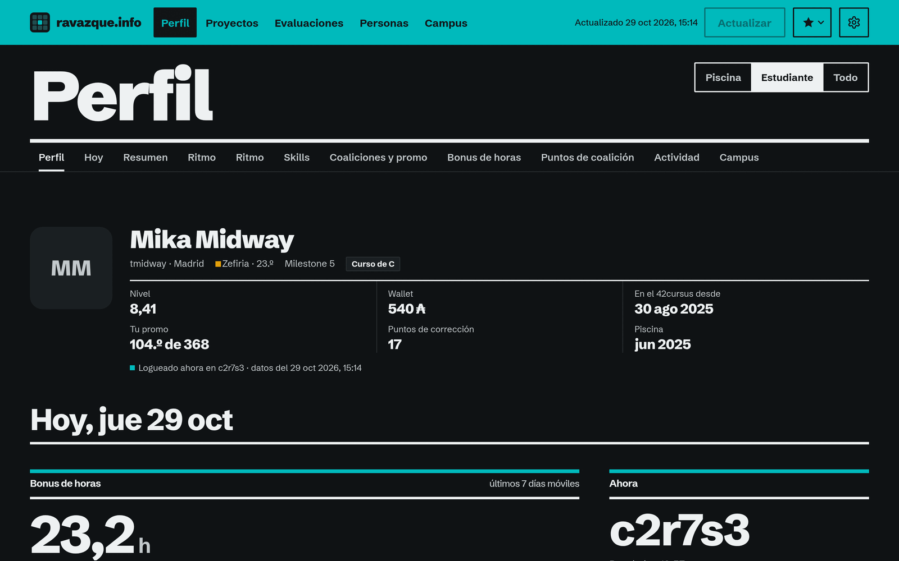
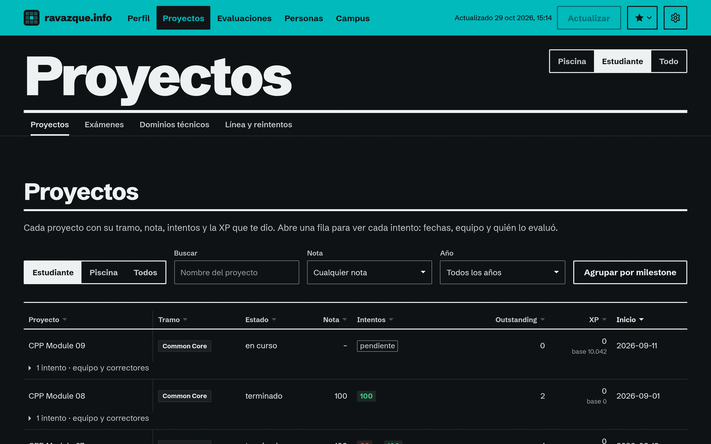
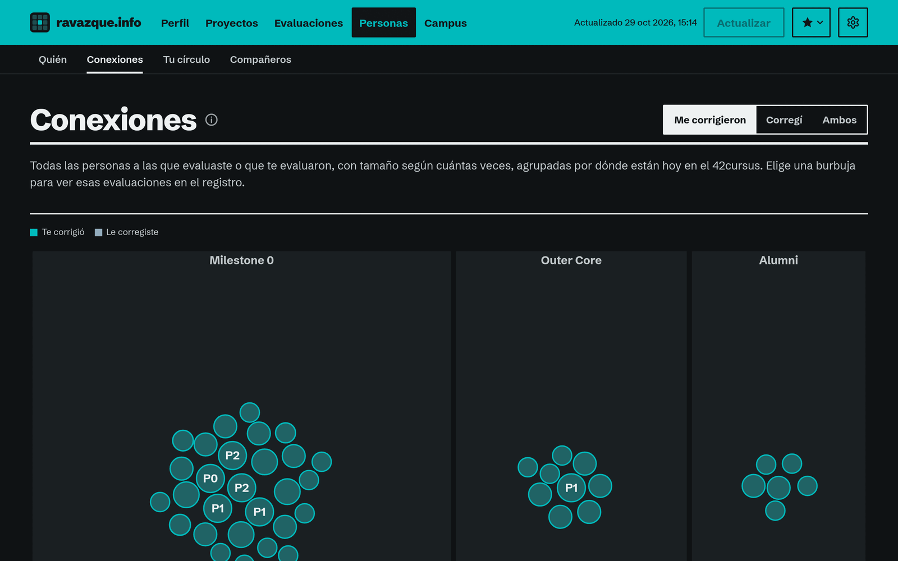
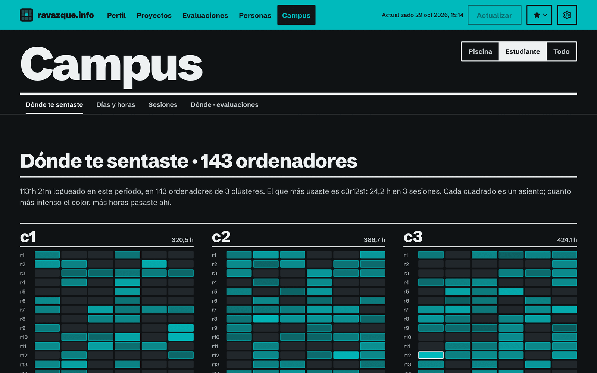
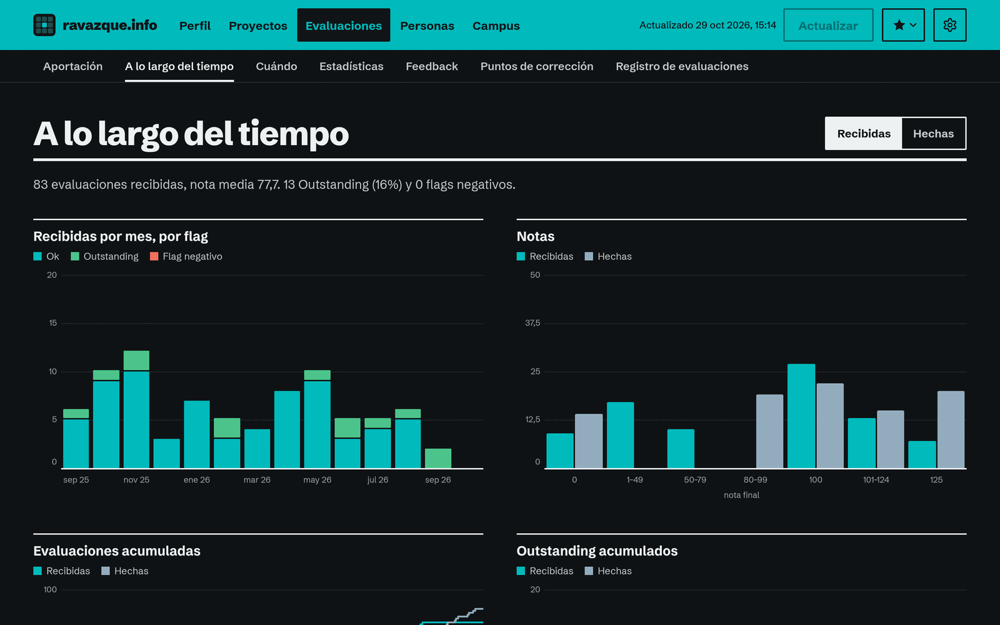

# ravazque.info

Estadísticas para estudiantes de **42 Madrid**, construidas sobre la API de 42. Inicia sesión con tu cuenta de 42 y
ve tu historia en un solo sitio: las horas que has logueado y dónde te sentaste, cada proyecto y cada reintento, tus
exámenes, cada evaluación que hiciste y recibiste, la gente con la que coincidiste, tu promo y tu coalición. En
español e inglés, claro y oscuro, en el azul de 42 o en el color de tu coalición.

En marcha en **https://ravazque.info**. Es un proyecto independiente: no está hecho, gestionado ni respaldado por 42
ni por 42 Madrid.

Este repositorio también contiene la página pública con el CV del autor (`site/`, servida en
https://ravazque.github.io), que muestra un pequeño resumen de 42 publicado desde la aplicación.

*<p align="left"> <c>Selector de idioma del README.md ➜</c> <b>Español</b> · <a href="../README.md">English</a></p>*

## Qué ves

Cinco páginas. Cada elección (periodo, filtros, vistas) queda en la dirección, así que cualquier vista se puede
guardar o compartir.

- **Perfil**, la página de inicio. Tu ficha (foto, milestone, curso de C o de Python, grado, grupos como mentor,
  wallet, puntos de corrección, inicio del 42cursus y piscina, la fecha estimada de alumni) y después lo que cambia
  hoy: el bonus de horas de la coalición (horas en los últimos siete días frente a 50 h y 80 h, cuándo toca cada uno y
  qué sesiones están a punto de salir de la ventana), dónde estás sentado, tus últimos siete días hora a hora, tu
  próxima evaluación y los proyectos que tienes abiertos. Debajo: seis módulos de resumen, tu ritmo, el avance y el
  blackhole, skills, coaliciones y promo, el bonus en detalle, los puntos que diste a tu coalición, logros, títulos y
  quests, y tus campus.
- **Proyectos**: cada proyecto e intento con filtros, agrupados por milestone (0 = Libft … 6) para el Common Core de
  C y el de Python, exportación a CSV, exámenes, dominios técnicos (las etiquetas RNCP de la intra) y una línea de
  tiempo con todos los intentos.
- **Evaluaciones**: lo que devuelves, recibidas y hechas a lo largo del tiempo, cuándo ocurren (día × hora, duración,
  con cuánta antelación se reservaron), estadísticas de corrección, tu feedback, puntos de corrección y el registro
  completo con búsqueda.
- **Personas**: quién te evaluó más, las conexiones entre la gente más cercana a ti, tu círculo y tus compañeros de
  equipo.
- **Campus**: el plano con cada ordenador que usaste, días y horas, sesiones y dónde ocurren las evaluaciones.

Cosas que merece la pena probar:

- El **selector de periodo**: todo, solo el 42cursus o solo la piscina.
- La **estrella** de la barra: un atajo a las mejores vistas (dónde te sentaste, quién te evaluó, tu círculo…).
- **Actualizar** tus datos una vez por hora; la extracción va en segundo plano con una barra de progreso.
- **Ajustes** (el engranaje): idioma, tema (sistema, claro u oscuro) y acento (azul de 42 o el color de tu coalición,
  ajustado para que se lea bien en los dos temas).
- **Borrar mis datos**: elimina al momento todo lo que el servidor guarda de ti.

Algunas cifras son deducciones, y la aplicación lo indica donde aparecen: la regla del bonus de horas (deducida de los
premios porque la intra no la publica, comprobada con 11 estudiantes durante 12 días), la fecha de alumni y la XP por
dominio.

<details>
<summary>Capturas (perfil de prueba, no un estudiante real; modo oscuro)</summary>
<br>

<p align="center">
  <a href="images/landing-es.png"></a>
  <a href="images/profile-es.png"></a>
</p>

<p align="center">
  <a href="images/projects-es.png"></a>
  <a href="images/people-es.png"></a>
</p>

<p align="center">
  <a href="images/campus-es.png"></a>
  <a href="images/evaluations-es.png"></a>
</p>

</details>

## Quién puede entrar

Estudiantes, transcenders y alumni cuyo campus principal es 42 Madrid. El staff, los piscineros y las cuentas en
blackhole o congeladas ven una página con el motivo. El acceso se comprueba de nuevo en cada actualización.

## Tus datos

- **Sin base de datos.** Tu informe vive en tu navegador (IndexedDB). El servidor guarda una copia firmada en memoria
  durante una hora desde su último uso, y solo acepta la copia del navegador si lleva su propia firma para tu cuenta.
- Tu token de 42 se usa una vez para saber quién eres y se descarta; los tokens nunca llegan al navegador.
- De otros estudiantes solo se guarda login, nombre y milestone. Del feedback que recibiste, solo el tuyo.
- El único fichero que escribe el servidor es el registro de aceptación: un hash con clave de tu id de 42, la versión
  de la política y la fecha, que se conserva dos años.
- *Borrar mis datos* elimina la copia del servidor, cancela una actualización pendiente y le pide a tu navegador que
  borre lo que guarda.
- Quien pide no aparecer sale como "Oculto" en los informes de los demás (`OPTOUT_LOGINS`).

La política completa está en la página de Privacidad de la aplicación. Problemas de seguridad: mira
[SECURITY.md](../SECURITY.md).

## Stack

- **Servidor**: Go 1.27, solo con la biblioteca estándar. Un único binario con el cliente y la extracción de la API
  de 42 (`server/api42/`), el análisis y las reglas del currículo (`server/core/`) y el servidor web: inicio de sesión
  con OAuth2 de 42, una API JSON, una cola de trabajos en el propio proceso y un almacén en memoria con caducidad
  (`server/internal/`).
- **Aplicación del navegador**: Vue 3.5, Vue Router 5 y TypeScript 5.9, compilada con Vite 8 e incrustada en el
  binario (`web/`). Las gráficas son SVG y HTML propios, sin librerías de gráficas.
- **Despliegue**: Docker Compose, Caddy 2.11 (HTTPS, cabeceras, compresión) y, en producción, un túnel de Cloudflare.
  La imagen se construye por etapas (Node 26 → Go 1.27 → distroless) y corre sin root; todas las imágenes base van
  fijadas por digest.
- **Tests**: `testing` de Go, Vitest 5 y `node --test`.
- `.v1_old/`: la primera versión (Python, FastAPI, htmx), archivada y sin compilar.

## Compilar y arrancar

```
make                 # lista los comandos
make certs           # certificados HTTPS para https://localhost (mkcert si está, si no openssl)
make dev             # compila y arranca https://localhost con tu informe guardado y los perfiles de prueba
make dev-logs        # sigue los logs de dev
make dev-down        # para dev (los navegadores conservan sus informes)
make build           # rehace la imagen de dev y tu informe guardado (DEV_UID, ~120 peticiones, ~40 s)
make test            # tests de Go, comprobación de tipos y Vitest, tests del sitio
make production      # compila y arranca https://ravazque.info a través del túnel de Cloudflare
make prod-down       # para producción (el registro de aceptación se queda en su volumen)
make logs            # sigue los logs de producción
make site            # compila la página del CV en site/_build y la sirve en http://localhost:8080
make snapshot        # site/data/42.json a partir del informe guardado: lo que enviaría el botón de publicar
make clean           # dev-down y los ficheros generados
make fclean          # clean, la imagen, volúmenes e informes guardados de dev, y web/node_modules
make re              # fclean y dev
```

`clean`, `fclean`, `re`, `build` y `test` nunca tocan producción: solo lo hacen `make production`, `make prod-down` y
`make logs`.

Requisitos: Docker con el plugin de Compose, `make`, y `mkcert` u `openssl`. Go 1.27 y Node 26 solo para
`make test` y las herramientas de desarrollo.

### Primera vez

1. Registra las aplicaciones de 42 en https://profile.intra.42.fr/oauth/applications (scope `public`): una para dev
   con la redirect URI `https://localhost/auth/callback` y otra para producción con
   `https://ravazque.info/auth/callback`. Una tercera es opcional y solo añade presupuesto de peticiones.
2. Ejecuta `make`: copia `.env.example` a `.env`. Rellénalo (abajo) y mantenlo privado (`chmod 600 .env`).
3. `make certs`, después `make dev`, y abre https://localhost.

### Configuración

Todo vive en un único `.env`, que nunca se sube al repositorio. `.env.example` explica cada valor:

```
FT_UID, FT_SECRET            # app de 42 con la que se entra en producción
FT_UID_2, FT_SECRET_2        # app de 42 con la que se entra en dev
FT_UID_3, FT_SECRET_3        # opcional: más presupuesto de peticiones, nunca inicia sesión
SESSION_SECRET               # openssl rand -hex 32
CONTROLLER_NAME              # responsable del tratamiento que nombra la política de privacidad
CONTACT_EMAIL                # contacto para solicitudes de privacidad (páginas Acerca de y Privacidad)
TUNNEL_TOKEN                 # producción: el token del túnel de Cloudflare
DEV_UID                      # dev: tu id de usuario de 42, cuyo informe guarda make build
OPTOUT_LOGINS                # opcional: logins que se muestran como "Oculto"
ISSUES_URL                   # opcional: enlace "Informar de un problema"
OWNER_LOGIN, GITHUB_TOKEN,   # opcional: el botón de publicar (oculto salvo que OWNER_LOGIN
GITHUB_REPO, GITHUB_BRANCH   #   y GITHUB_TOKEN estén definidos)
```

## Modos

- **Dev** (`make dev`, https://localhost) entra con la segunda app de 42. La página de entrada ofrece además
  **Dev · login**, que entra con tu informe guardado sin pasar por 42, y tres perfiles **Test** (un estudiante nuevo,
  uno a mitad del Common Core y un alumni): datos sintéticos movidos a la fecha de hoy, nunca personas reales, que no
  pueden publicar ni actualizar. Un cambio en el código necesita `make dev` de nuevo.
- **Producción** (`make production`, https://ravazque.info) entra con la primera app y se sirve a través de un túnel
  de Cloudflare con nombre (Zero Trust → Networks → Tunnels: un conector Docker cuyo hostname público apunta a
  `http://caddy:8080`; su token va en `TUNNEL_TOKEN`). Dev y producción son proyectos de Compose distintos y pueden
  funcionar a la vez.

### El presupuesto de la API de 42

Cada app de 42 puede hacer 2 peticiones por segundo y 1200 por hora, compartidas por todos los usuarios, así que la
aplicación las cuida:

- una actualización por usuario y hora, de una en una;
- listas pedidas en lotes de 100, y las listas independientes a la vez;
- peticiones repartidas entre todas las apps configuradas.

Una actualización completa son unas 120 peticiones y 40 segundos con tres apps, y cada actualización registra cuántas
peticiones ha hecho. Cuando queda poco presupuesto en la hora, el trabajo espera a la siguiente.

## La página pública y su workflow

`site/` es una página estática con el CV del autor (`site/cv.json`, editado a mano, EN/ES) y un resumen de 42
(`site/data/42.json`). El botón **Publicar** de la aplicación (solo para el autor) escribe ese resumen y lo sube a
`main` mediante la API de GitHub. El resumen es una lista cerrada de campos: nivel, estado del cursus, proyectos
validados, recuento de evaluaciones, coalición y mejores skills. Nunca incluye datos de contacto, asientos, horas,
ids, tokens, fotos ni nada sobre otros estudiantes.

Puesta en marcha:

1. Crea un token fine-grained en https://github.com/settings/personal-access-tokens con acceso solo a este
   repositorio y **Contents: Read and write**. Ponlo en `GITHUB_TOKEN`, junto con `GITHUB_REPO` y `OWNER_LOGIN`.
2. En Settings → Pages, elige **Source: GitHub Actions**, para que solo se publique `site/`.
3. Como el botón sube a `main`, haz `git pull --rebase` antes de subir trabajo local.

## CI/CD

Cada push y cada pull request ejecutan `.github/workflows/ci.yml`:

- `go`: vet, tests con el detector de carreras y govulncheck;
- `web`: comprobación de tipos, tests, compilación y `npm audit` de la aplicación del navegador, y los tests del sitio;
- `image`: la imagen de Docker compila;
- `secrets`: gitleaks sobre todo el historial, y un control de que no se sube ningún fichero privado (`.env`,
  resultados de compilación, carpetas locales).

`main` está protegida: los cuatro checks tienen que pasar, y el force-push y el borrado están bloqueados. Cuando el
CI pasa en `main`, `pages.yml` despliega `site/` en GitHub Pages. CodeQL analiza Go, TypeScript y los workflows, y
Dependabot propone actualizaciones semanales para Go, npm, Docker y Actions. Las Actions van fijadas por SHA de commit.

La aplicación web no la despliega el CI: producción corre en la máquina del autor y se actualiza con
`make production`.

## Tests

`make test` lo ejecuta todo:

- los tests de Go junto a su código en `server/`. El análisis se compara con ficheros golden que generó la primera
  versión a partir de los mismos datos, incluido el orden de las claves;
- los tests de la aplicación del navegador en `web/src/` (Vitest), que también comprueban que cada texto existe en
  los dos idiomas;
- los tests del sitio en `site/tests/`.

Los datos de prueba están anonimizados o son sintéticos.

## Personalizar

- `server/core/data/ui.json`: colores de los dos temas, tipografía, espaciado, puntos de corte y disposición de los
  paneles, servido como `/ui.css`.
- `server/core/data/i18n/{en,es}.json`: todos los textos; los dos ficheros deben tener las mismas claves.
- `server/core/data/tracks.json`: a qué milestone del Common Core pertenece cada proyecto, para los cursos de C y de
  Python. Cualquier otro proyecto del 42cursus cuenta como Outer Core.
- `server/core/data/skills.json` (orden de las skills) y `rncp.json` (los proyectos detrás de cada etiqueta RNCP).

## Licencia

[AGPL-3.0](../LICENSE). Si ofreces una versión modificada como servicio en red, debes ofrecer su código a sus
usuarios.
