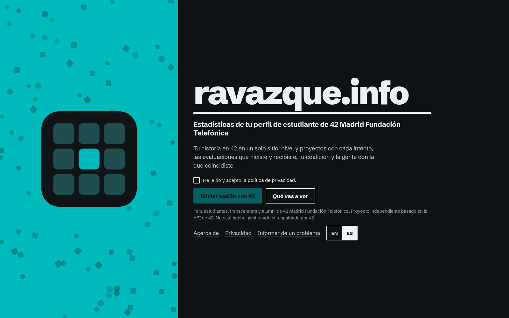
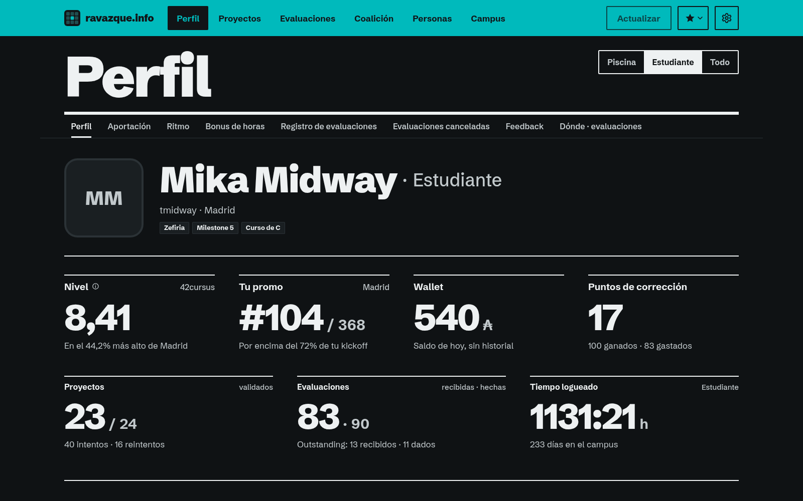
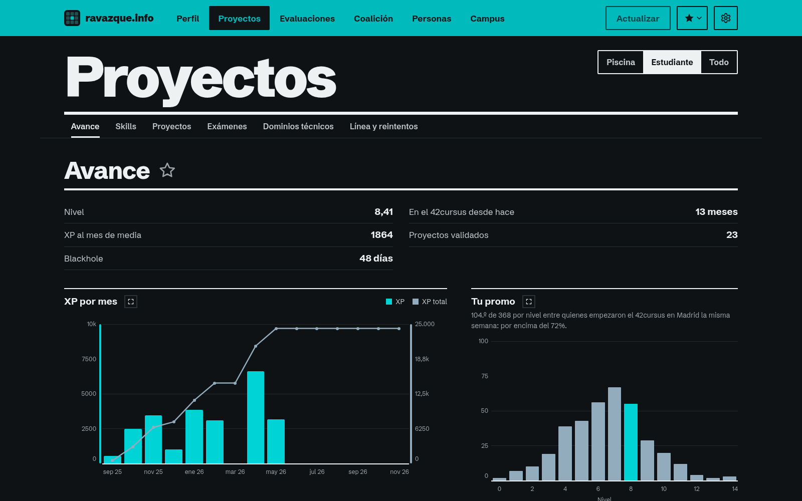
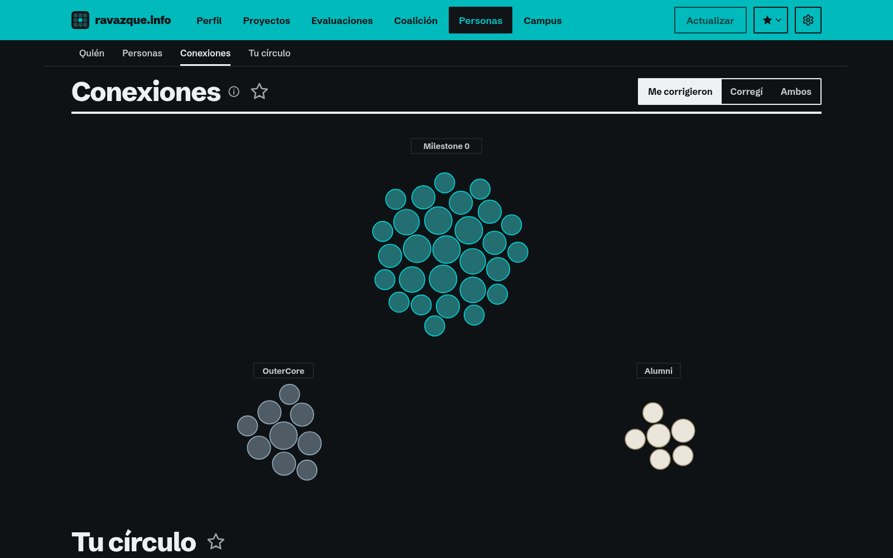
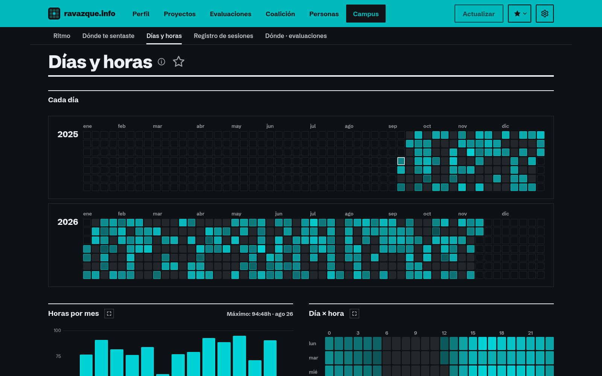
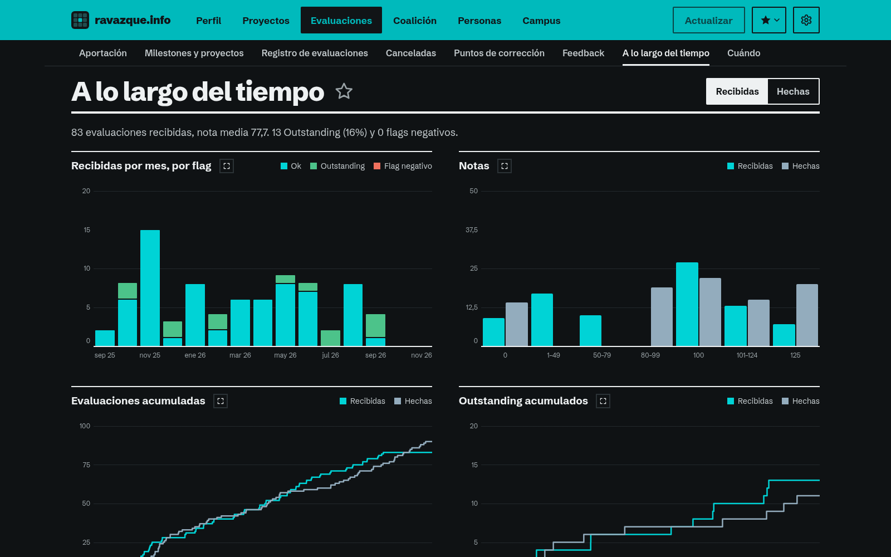

# ravazque.info

Estadísticas para estudiantes de **42 Madrid Fundación Telefónica**, construidas sobre la API de 42. Inicia sesión con tu cuenta de 42 y
ve tu historia en un solo sitio: las horas que has logueado y dónde te sentaste, cada proyecto y cada reintento, tus
exámenes, cada evaluación que hiciste y recibiste, la gente con la que coincidiste, tu promo y tu coalición. En
español e inglés, claro y oscuro, en el azul de 42 o en el color de tu coalición.

En marcha en **https://ravazque.info**. Es un proyecto independiente: no está hecho, gestionado ni respaldado por 42
ni por 42 Madrid Fundación Telefónica.

Este repositorio también contiene la página pública con el CV del autor (`site/`, servida en
https://ravazque.github.io), que muestra un pequeño resumen de 42 publicado desde la aplicación.

*<p align="left"> <c>Selector de idioma del README.md ➜</c> <b>Español</b> · <a href="../README.md">English</a></p>*

## Qué ves

Seis páginas. Cada elección (periodo, filtros, vistas) queda en la dirección, así que cualquier vista se puede
guardar o compartir.

- **Perfil**, la página de inicio. Tu ficha (foto, nombre y login, el título que elegiste en la intra, coalición,
  milestone, curso de C o de Python, grado, grupos como mentor) con cuatro cifras, cada una con su línea: tu nivel y tu
  posición entre los estudiantes, OuterCore, congelados y alumni de Madrid (se vuelve a leer cada hora), tu puesto en tu
  kickoff, tu wallet y tus puntos de corrección ganados y gastados. Después tres módulos de resumen (proyectos,
  evaluaciones y horas), tu recorrido en una línea de tiempo (piscina, 42cursus, cambios de campus, Transcender, alumni,
  hoy y la fecha estimada de alumni) y las secciones de las otras páginas que guardes como widgets: para empezar,
  Contribución, Ritmo, el bonus de horas, el registro de evaluaciones, las evaluaciones canceladas, el feedback y dónde
  ocurren las evaluaciones. Añade más desde el selector del final (Actividad entre ellas: logros, eventos, títulos y
  quests junto a tus campus), quítalos, cambia su tamaño y arrástralos a su sitio; se guarda en tu navegador.
- **Proyectos**: tu avance (nivel, XP por mes, tu promo por nivel, la fecha estimada de alumni), skills, cada proyecto
  e intento con filtros, agrupados por milestone (0 = Libft … 6) para el Common Core de C y el de Python (un proyecto
  hecho en los dos cursos dice cuál es cuál), exportación a CSV, exámenes, dominios técnicos (las etiquetas RNCP de la
  intra), una línea de tiempo con todos los intentos.
- **Evaluaciones**: lo que devuelves (horas, personas, valoración, cuántas acabaron por debajo de 50, Outstanding en
  los dos sentidos, según el milestone de la otra persona), recibidas y hechas a lo largo del tiempo, cuándo ocurren
  (día × hora, duración, con cuánta antelación se reservaron), tu feedback (como estudiante solo
  cuenta el 42cursus; las piscinas Discovery van aparte), los puntos de corrección, las evaluaciones canceladas (las de
  tus proyectos que cancelaste tú, con el proyecto que probablemente eran; las que canceló tu corrector; las que ibas a
  hacer y cancelaste; las veces que tu corrector no vino), los proyectos que has corregido y el registro completo de
  evaluaciones: búsqueda y filtros por flag (también ausencias), milestone del proyecto, proyecto y asiento (sin login,
  login tarde, por clúster), quién marcó ausente a quién, cuánto tarde hizo login la parte evaluada, y el líder de un
  equipo con el resto a un clic.
- **Coalición**: las coaliciones de Madrid, actualizadas cada cuarto de hora, y cada punto que diste a la tuya, el bonus
  de horas en detalle con todos los bonus hasta ahora, tus puntos por origen (todos, también los que están a cero) y por
  mes y origen (pasa el ratón por un mes para ver sus partes). Las deducciones salen como TIGs.
- **Personas**: quién te evaluó más, todas las personas con las que coincidiste (o solo tus compañeros de equipo), tus
  conexiones agrupadas por dónde están hoy y tu círculo. Las cuentas que 42 borró no aparecen en los gráficos (una nota dice
  cuántas) y en las tablas salen como "Cuenta borrada"; el staff tiene su propio grupo. Un login de una tabla o lista
  abre la página de ese estudiante en acerezo.top, otro sitio independiente, en una pestaña nueva.
- **Campus**: tu ritmo (racha, semanas activas, tu día hora a hora), el plano con cada ordenador que usaste (los que
  están fuera de los clústeres, aparte), días y horas (el primer año completo, con tu primer día marcado), el registro
  de sesiones, dónde ocurren las evaluaciones (las que recibiste o hiciste, por clúster, con el clúster de la otra
  persona en los últimos 60 días). Las sesiones en otros campus cuentan como horas pero no entran en los asientos ni
  clústeres de Madrid.

Cosas que merece la pena probar:

- El **selector de periodo**: todo, solo el 42cursus o solo la piscina.
- La **estrella** junto al título de cada sección: las secciones marcadas se reúnen en el menú de la estrella de la barra, a un clic.
- **Actualizar** tus datos una vez por hora; la extracción va en segundo plano con el progreso en la barra, y cuando
  vuelves pasada una hora la copia de tu navegador dibuja la página al momento mientras se trae una nueva.
- El botón de **ampliar** junto a una gráfica que comparte fila (en el móvil, todas) la abre en grande.
- **Ajustes** (el engranaje): acento (el azul de 42 por defecto o el color de tu coalición, ajustado para que se lea
  bien en los dos temas), tema (sistema, claro u oscuro), periodo e idioma.
- **Borrar mis datos**: elimina al momento todo lo que el servidor guarda de ti.

Algunas cifras son deducciones, y la aplicación lo indica donde aparecen: la regla del bonus de horas (deducida de los
premios porque la intra no la publica, comprobada con 11 estudiantes durante 12 días), la fecha de alumni, la XP por
dominio, los asientos y retrasos calculados con las sesiones de login, y qué evaluaciones canceladas cancelaste tú (con
el proyecto que probablemente eran). 42 borra una evaluación cancelada, así que se leen de tus puntos de corrección;
cuando cancela el estudiante al que ibas a evaluar no se escribe nada en tu lado y no se puede contar.

<details>
<summary>Capturas (perfil de prueba, no un estudiante real; modo oscuro)</summary>
<br>

<p align="center">
  <a href="images/landing-es.png"></a>
  <a href="images/profile-es.png"></a>
</p>

<p align="center">
  <a href="images/projects-es.png"></a>
  <a href="images/people-es.png"></a>
</p>

<p align="center">
  <a href="images/campus-es.png"></a>
  <a href="images/evaluations-es.png"></a>
</p>

</details>

## Quién puede entrar

Estudiantes, transcenders y alumni cuyo campus principal es 42 Madrid Fundación Telefónica. El staff, los piscineros y las cuentas en
blackhole o congeladas ven una página con el motivo. El acceso se comprueba de nuevo en cada actualización.

## Tus datos

- **Sin base de datos.** Tu informe vive en tu navegador (IndexedDB). El servidor guarda una copia firmada en memoria
  durante una hora desde su último uso, y solo acepta la copia del navegador si lleva su propia firma para tu cuenta.
- Tu token de 42 se usa una vez para saber quién eres y se descarta; los tokens nunca llegan al navegador.
- De otros estudiantes solo se guarda login, nombre, grupo (milestone, alumni, blackhole…) y si son staff y, en tus
  evaluaciones de los últimos 60 días, el asiento que usó la otra parte (y cuánto tarde hicieron login los estudiantes que
  evaluaste). Del feedback que recibiste, solo el tuyo.
- El único fichero que escribe el servidor es el registro de aceptación: un hash con clave de tu id de 42, la versión
  de la política y la fecha, que se conserva dos años.
- *Borrar mis datos* elimina la copia del servidor, cancela una actualización pendiente y le pide a tu navegador que
  borre lo que guarda.
- Quien pide no aparecer sale como "Hidden", sin nombre ni asiento, en los informes de los demás (`OPTOUT_LOGINS`).
- Para tu posición en Madrid, el servidor lee el nivel de todos los estudiantes del 42cursus de Madrid una vez por hora
  (solo en las horas en que alguien abre una página) y guarda solo los números, en memoria: ningún login, nombre ni id.
- Un enlace de login a acerezo.top solo le manda ese login a ese sitio cuando haces clic, sin decirle desde qué página llegas.
- El servidor corre en Amazon Web Services, en la UE (Estocolmo), y se llega a él a través de Cloudflare.

La política completa está en la página de Privacidad de la aplicación. Problemas de seguridad: mira
[SECURITY.md](../SECURITY.md).

## Stack

- **Servidor**: Go 1.27, solo con la biblioteca estándar. Un único binario con el cliente y la extracción de la API
  de 42 (`server/api42/`), el análisis y las reglas del currículo (`server/core/`) y el servidor web: inicio de sesión
  con OAuth2 de 42, una API JSON, una cola de trabajos en el propio proceso y un almacén en memoria con caducidad
  (`server/internal/`).
- **Aplicación del navegador**: Vue 3.5, Vue Router 5 y TypeScript 5.9, compilada con Vite 8 e incrustada en el
  binario (`web/`). Las gráficas son SVG y HTML propios, sin librerías de gráficas.
- **Despliegue**: Docker Compose, Caddy 2.11 (HTTPS, cabeceras, compresión) y, en producción, un túnel de Cloudflare.
  La imagen se construye por etapas (Node 26 → Go 1.27 → distroless) y corre sin root; todas las imágenes base van
  fijadas por digest.
- **Tests**: `testing` de Go, Vitest 5 y `node --test`.

## Compilar y arrancar

```
make                 # lista los comandos
make certs           # certificados HTTPS para https://localhost (mkcert si está, si no openssl)
make dev             # compila, arranca y abre https://localhost en Chrome sin perfiles guardados (solo inicio de sesión real con 42)
make dev-build       # dev más los perfiles de prueba sintéticos
make dev-real        # dev-build más los perfiles reales de DEV_REAL_LOGINS (se descargan una vez, ~120 peticiones cada uno)
make dev-live        # dev-real más edición en vivo: abre en Chrome la app del navegador desde web/src en http://localhost:5173
make dev-logs        # sigue los logs de dev
                     # cada nivel de dev se engancha a un dev ya levantado, salvo que cambien el código, los ajustes o el nivel; make dev-down baja de nivel
make dev-down        # para dev (los navegadores conservan sus informes)
make test            # tests de Go, comprobación de tipos y Vitest, tests del sitio y del informe de evaluaciones
make production      # compila y arranca https://ravazque.info a través del túnel de Cloudflare
make production-down # para producción (el registro de aceptación se queda en su volumen)
make logs            # sigue los logs de producción
make site            # compila la página del CV en site/_build y la sirve en http://localhost:8080
make snapshot        # site/data/42.json a partir del informe guardado: lo que enviaría el botón de publicar
make eval-report     # pide un login de 42 y escribe su historial de evaluaciones en una página HTML privada (~130 peticiones)
make report          # lo mismo, y abre la página en Chrome
make clean           # dev-down y los ficheros generados
make fclean          # clean, la imagen, volúmenes e informes guardados de dev, y web/node_modules
make re              # fclean y dev-build
```

`clean`, `fclean`, `re` y `test` nunca tocan producción: solo lo hacen `make production`, `make production-down` y
`make logs`.

Requisitos: Docker con el plugin de Compose, `make`, y `mkcert` u `openssl`. Go 1.27, Node 26 y Python 3.12 solo
para `make test` y las herramientas de desarrollo.

### Primera vez

1. Registra las aplicaciones de 42 en https://profile.intra.42.fr/oauth/applications (scope `public`): una para dev
   con la redirect URI `https://localhost/auth/callback` y otra para producción con
   `https://ravazque.info/auth/callback`. Una tercera es opcional y solo añade presupuesto de peticiones.
2. Ejecuta `make`: copia `.env.example` a `.env`. Rellénalo (abajo) y mantenlo privado (`chmod 600 .env`).
3. `make certs`, después `make dev-build`: https://localhost se abre en Chrome.

### Configuración

Todo vive en un único `.env`, que nunca se sube al repositorio. `.env.example` explica cada valor:

```
FT_UID, FT_SECRET            # app de 42 con la que se entra, en producción y en dev; también responde peticiones
FT_UID_2, FT_SECRET_2        # opcional: más presupuesto de peticiones, nunca inicia sesión
FT_UID_3, FT_SECRET_3        # opcional: más presupuesto de peticiones, nunca inicia sesión
SESSION_SECRET               # openssl rand -hex 32
CONTROLLER_NAME              # responsable del tratamiento que nombra la política de privacidad
CONTACT_EMAIL                # contacto para solicitudes de privacidad (páginas Acerca de y Privacidad)
TUNNEL_TOKEN                 # producción: el token del túnel de Cloudflare
DEV_REAL_LOGINS              # dev: logins de 42 (separados por comas) cuyos informes reales sirve make dev-real
OPTOUT_LOGINS                # opcional: logins que se muestran como "Hidden"
ISSUES_URL                   # opcional: enlace "Informar de un problema"
OWNER_LOGIN, GITHUB_TOKEN,   # opcional: el botón de publicar (oculto salvo que OWNER_LOGIN
GITHUB_REPO, GITHUB_BRANCH   #   y GITHUB_TOKEN estén definidos)
```

## Modos

- **Dev** (`make dev-build`, https://localhost) entra con la segunda app de 42. La página de entrada ofrece además
  siete perfiles **Test** (un estudiante nuevo, uno a mitad del Common Core, un transcender del Outer Core, un alumni,
  un estudiante de la rama Python, un transcender de la rama Python y un estudiante que pasó de C a Python): datos
  sintéticos movidos a la fecha de hoy, nunca personas reales, que no pueden publicar ni actualizar. `make dev-real`
  añade **Real · login** para los logins de `DEV_REAL_LOGINS`, guardados en `web/preview/` (solo en local). Un cambio
  en el código necesita `make dev-build` de nuevo; `make dev-live` muestra al momento los cambios de la app del navegador
  (`ui.json` y el servidor siguen necesitando reconstruir).
- **Producción** (`make production`, https://ravazque.info) entra con la primera app y se sirve a través de un túnel
  de Cloudflare con nombre (Zero Trust → Networks → Tunnels: un conector Docker cuyo hostname público apunta a
  `http://caddy:8080`; su token va en `TUNNEL_TOKEN`). Dev y producción son proyectos de Compose distintos y pueden
  funcionar a la vez. Corre en una sola máquina, hoy un EC2 de AWS en Estocolmo.

### Actualizar producción

En la máquina que la sirve:

```
git pull --rebase    # el código nuevo (y lo que haya subido el botón de publicar)
make production-down # opcional: para los contenedores; los volúmenes (el registro de aceptación) se quedan
make production      # reconstruye la imagen con el código que tienes y la vuelve a arrancar
```

`make production` solo también sirve: reconstruye y sustituye solo lo que cambió, con unos segundos sin servicio.
Nunca añadas `-v` a un `down` a mano: eso borra los volúmenes, también el registro de aceptación. Lo que se pierde al
reiniciar es la memoria: todo el mundo vuelve a iniciar sesión y su informe vuelve desde su navegador (la firma del
servidor sigue valiendo mientras `SESSION_SECRET` no cambie). Los datos nuevos que añade una versión al informe
aparecen tras la siguiente actualización de cada persona.

### El presupuesto de la API de 42

Cada app de 42 puede hacer 2 peticiones por segundo y 1200 por hora, compartidas por todos los usuarios, así que la
aplicación las cuida:

- una actualización por usuario y hora, de una en una;
- listas pedidas en lotes de 100, y las listas independientes a la vez;
- peticiones repartidas entre todas las apps configuradas.

Una actualización completa son unas 120 peticiones y 40 segundos con tres apps, y cada actualización registra cuántas
peticiones ha hecho. Cuando queda poco presupuesto en la hora, el trabajo espera a la siguiente. Los niveles de Madrid
(tu posición en Perfil) cuestan unas 26 peticiones, como mucho una vez por hora, compartidas por todos, y solo en una
hora en la que alguien abre una página.

## La página pública y su workflow

`site/` es una página estática con el CV del autor (`site/cv.json`, editado a mano, EN/ES) y un resumen de 42
(`site/data/42.json`). El botón **Publicar** de la aplicación (solo para el autor) escribe ese resumen y lo sube a
`main` mediante la API de GitHub. El resumen es una lista cerrada de campos: nivel, estado del cursus, proyectos
validados, recuento de evaluaciones, coalición y mejores skills. Nunca incluye datos de contacto, asientos, horas,
ids, tokens, fotos ni nada sobre otros estudiantes.

Puesta en marcha:

1. Crea un token fine-grained en https://github.com/settings/personal-access-tokens con acceso solo a este
   repositorio y **Contents: Read and write**. Ponlo en `GITHUB_TOKEN`, junto con `GITHUB_REPO` y `OWNER_LOGIN`.
2. En Settings → Pages, elige **Source: GitHub Actions**, para que solo se publique `site/`.
3. Como el botón sube a `main`, haz `git pull --rebase` antes de subir trabajo local.

## CI/CD

Cada push y cada pull request ejecutan `.github/workflows/ci.yml`:

- `go`: vet, tests con el detector de carreras y govulncheck;
- `web`: comprobación de tipos, tests, compilación y `npm audit` de la aplicación del navegador, los tests del sitio y los del informe de evaluaciones;
- `image`: la imagen de Docker compila;
- `secrets`: gitleaks sobre todo el historial, y un control de que no se sube ningún fichero privado (`.env`,
  resultados de compilación, carpetas locales).

`main` está protegida: los cuatro checks tienen que pasar, y el force-push y el borrado están bloqueados. Cuando el
CI pasa en `main`, `pages.yml` despliega `site/` en GitHub Pages. CodeQL analiza Go, TypeScript y los workflows, y
Dependabot propone actualizaciones semanales para Go, npm, Docker y Actions. Las Actions van fijadas por SHA de commit.

La aplicación web no la despliega el CI: producción corre en la máquina del autor y se actualiza con
`make production`.

## Tests

`make test` lo ejecuta todo:

- los tests de Go junto a su código en `server/`. El análisis se compara con ficheros golden guardados, incluido el
  orden de las claves;
- los tests de la aplicación del navegador en `web/src/` (Vitest), que también comprueban que cada texto existe en
  los dos idiomas;
- los tests del sitio en `site/tests/`;
- los tests del informe de evaluaciones en `tools/evaluation-report/`.

Los datos de prueba están anonimizados o son sintéticos.

## Herramientas

- [`tools/evaluation-report`](../tools/evaluation-report/README.md): `make eval-report` pide un login de 42 y escribe el historial de
  evaluaciones de ese estudiante en una página HTML privada: cada intento con sus correctores, tiempos y asientos. Se ejecuta
  en local, no forma parte de la aplicación desplegada y podría convertirse en una página de ella más adelante. Oculta a los
  estudiantes de `OPTOUT_LOGINS` igual que la aplicación, pero queda fuera de la política de privacidad del sitio: mira su
  sección Privacy.

## Personalizar

- `server/core/data/ui.json`: colores de los dos temas, tipografía, espaciado, puntos de corte y disposición de los
  paneles, servido como `/ui.css`.
- `web/src/styles/spacing.css`: cada distancia y línea de cada página, sección a sección, para ajustar a mano (los
  valores negativos acercan más).
- `web/src/styles/zoom.css`: el panel que abre una gráfica en grande (ancho, alto, posición, márgenes, alto de la
  gráfica, cuánto se oscurece la página de detrás).
- `server/core/data/i18n/{en,es}.json`: todos los textos; los dos ficheros deben tener las mismas claves.
- `server/core/data/tracks.json`: a qué milestone del Common Core pertenece cada proyecto, para los cursos de C y de
  Python. Cualquier otro proyecto del 42cursus cuenta como Outer Core.
- `server/core/data/skills.json` (orden de las skills) y `rncp.json` (los proyectos detrás de cada etiqueta RNCP).

## Licencia

[AGPL-3.0](../LICENSE). Si ofreces una versión modificada como servicio en red, debes ofrecer su código a sus
usuarios.
